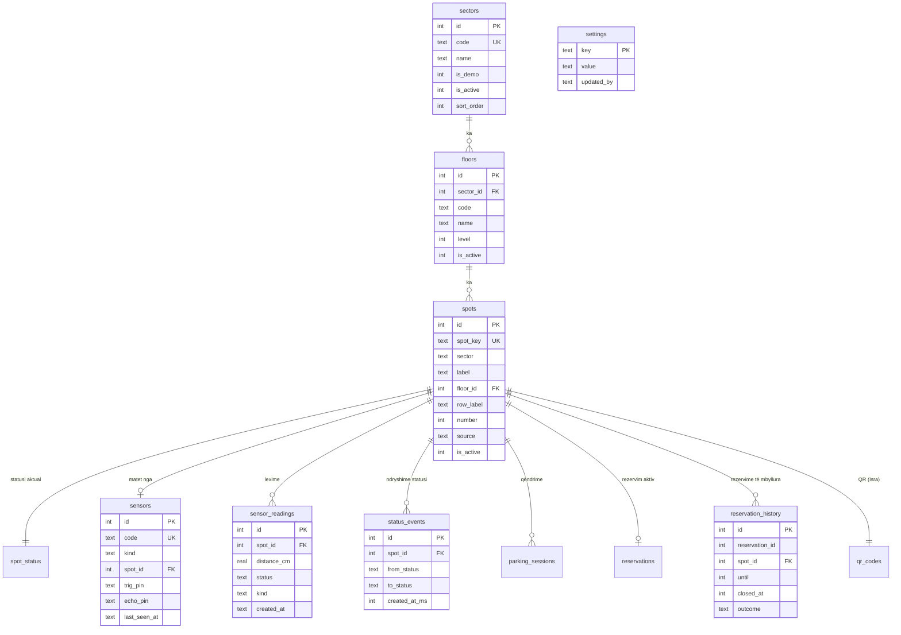

# Databaza e parkimit (SQLite)

Pronari i skemës **parking**: Erdi. Databaza është SQLite (`better-sqlite3`), skedari `backend/data/parking.db` (nuk futet në git).
Skemat **qr** (Isra) dhe **auth** (Emir) nuk ndryshohen këtu.

## Diagrami ER



Tabela të tjera: `schema_migrations` (cilët migrime janë aplikuar), `gate_events` (hyrje/dalje nga ura),
`entrance_events` (VIEW mbi `gate_events`, sensori S7). Skema e plotë është te
[`backend/src/db/schema.snapshot.sql`](../backend/src/db/schema.snapshot.sql).

## Rregullat e strukturës

- `spot_key` = `<sektori>-<etiketa>` (p.sh. `A-P1`) dhe **nuk ndryshohet** pasi krijohet (QR-të e Isrës e përdorin).
- Kati i një vendi duhet të jetë në të njëjtin sektor (trigger).
- Çdo vend i ri merr automatikisht rreshtin `spot_status` dhe një QR.
- Vendet me sensor live ose me histori nuk fshihen (409): çaktivizohen.
- Sensorët S1–S6 janë te vendet e sektorit A (pinat D2/D3 … D12/D13), S7 te hyrja (A0/A1).

## Migrimet (D1, D7)

Migrimet janë te `backend/src/db/migrations/NNN_emri.sql` dhe aplikohen automatikisht kur niset backend-i.

| Skedari | Çfarë bën |
|---|---|
| `001_parking_structure.sql` | sektorët, katet, sensorët, parametrat; plotëson nga të dhënat ekzistuese |
| `002_readings_policy.sql` | politika e leximeve, `status_events` |
| `003_entrance_and_history.sql` | indekset, VIEW e hyrjes, historiku i rezervimeve |

**Procesi i ndryshimit (D7):**
1. Kurrë mos ndrysho një migrim që është aplikuar: shto skedarin tjetër me numër (`004_…sql`). Një migrim i ndryshuar refuzohet (checksum sha256).
2. Numrat janë pa vrima dhe pa dublikime (testi e kontrollon).
3. Pas migrimit ekzekuto `npm run db:snapshot` dhe fut në commit `schema.snapshot.sql`, që reviewer-i ta shohë diff-in e skemës.
4. `npm test` duhet të kalojë (testi i snapshot-it dështon nëse skema dhe snapshot-i ndryshojnë).
5. PR-ja kërkon review nga pronari i skemës (parking → Erdi).

## Politika e leximeve (D2)

- Ruhen vetëm **ndryshimet**: një lexim me të njëjtin status dhe distancë brenda tolerancës injorohet (trigger `RAISE(IGNORE)`), por `last_seen` i sensorit përditësohet.
- Çdo `sample_interval_s` ruhet një **mostër** (`kind = 'sample'`) edhe pa ndryshim.
- Çdo ndryshim statusi shkruhet në `status_events` (koha në ms).
- Rezervimet e mbyllura kalojnë në `reservation_history` me rezultatin `fulfilled` / `expired` / `cancelled`.

| Parametri (paneli → Parametrat) | Default |
|---|---|
| Pragu i zënies | 3 cm |
| Toleranca e ndryshimit | 0.5 cm |
| Mostra periodike | 300 s |
| Sensori offline pas | 30 s |
| Ruajtja e mostrave | 30 ditë |
| Ruajtja e ndryshimeve | 180 ditë |

Parametrat ruhen në tabelën `settings` dhe zbatohen menjëherë pa rinisje.

## Statistikat (D3)

`GET /api/stats/summary?days=7&sector=A` (publike, maksimum 92 ditë). Koha llogaritet sipas Europe/Belgrade.

- **Zënia mesatare** = minutat e zëna të vendeve aktive / minutat totale, nga `parking_sessions` (mbivendosja për orë).
- **Ora e pikut** = ora e ditës me zënien mesatare më të lartë.
- **Kohëzgjatja** = mesatarja dhe mediana e qëndrimeve të mbyllura.
- **Hyrjet** = `entrance_events` (sensori S7), për ditë.
- **Sensorët** = online nëse janë parë brenda `sensor_timeout_s`; gabimet = lexime pa echo.

## Të dhënat DEMO (D4)

```bash
cd backend
npm run seed:demo          # krijon sektorin D (DEMO) me qëndrime, lexime dhe rezervime
```

Prek vetëm sektorët me `is_demo = 1`; mund të ekzekutohet sa herë të duash. Sektori A me sensorët e vërtetë nuk preket.

## Raportet dhe paneli (D5)

Paneli admin ka tre seksione të reja: **Struktura** (sektorë, kate, vende), **Parametrat**, **Raportet** (KPI, grafiku për orë, sensorët, CSV).
CSV-të (`/api/admin/reports/<lloji>.csv`, llojet: sessions, readings, status-events, entrance, reservations) kanë BOM për Excel dhe mbrohen nga formulat (`=`, `+`, `-`, `@`).
Shkrimet kërkojnë rolin admin dhe shkruhen në `audit_log`.

## Mirëmbajtja (D6)

```bash
cd backend
npm run db:check                     # 16 kontrolle integriteti (foreign keys, statuse, sensorë, …)
npm run db:backup                    # kopje në backend/data/backups/ (verifikohet pas krijimit)
npm run db:restore -- <skedari.db>   # rikthen; ruan më parë një kopje sigurie
npm run db:purge                     # fshin mostrat/ndryshimet më të vjetra se politika
npm run db:snapshot                  # rigjeneron schema.snapshot.sql
```

Nga paneli: Raportet → *Integriteti i databazës* (kontroll, backup për shkarkim, pastrim me dy hapa).
Para `db:restore` ndalo backend-in.
