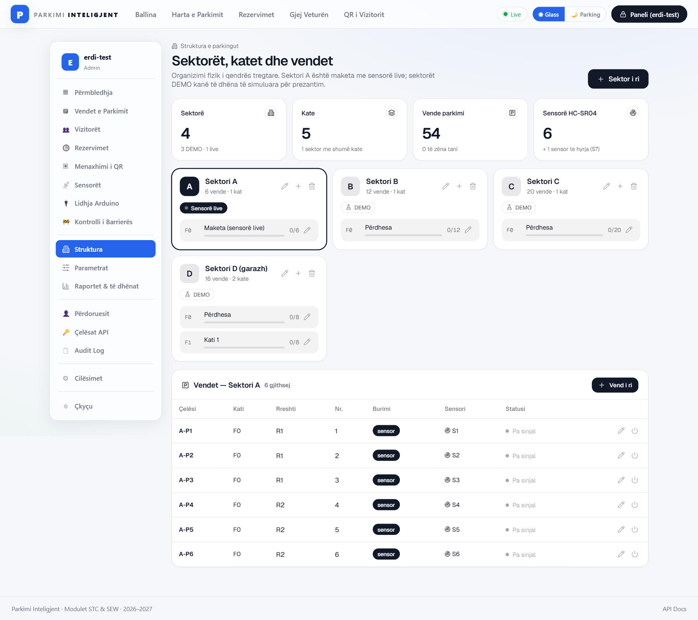
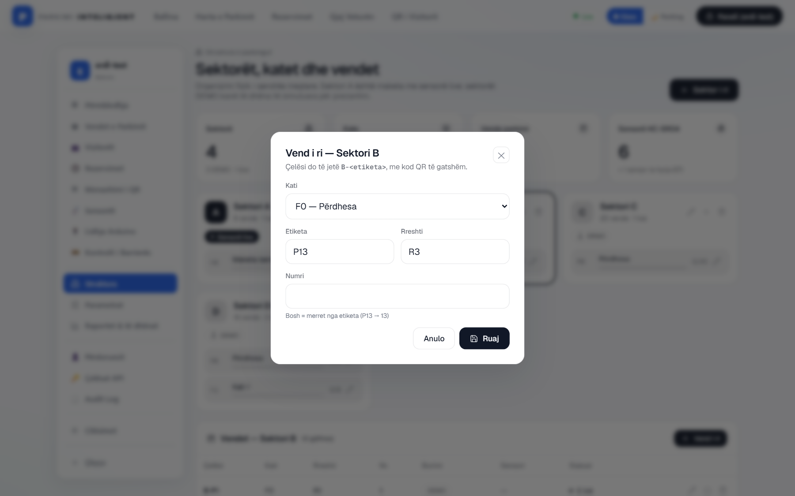
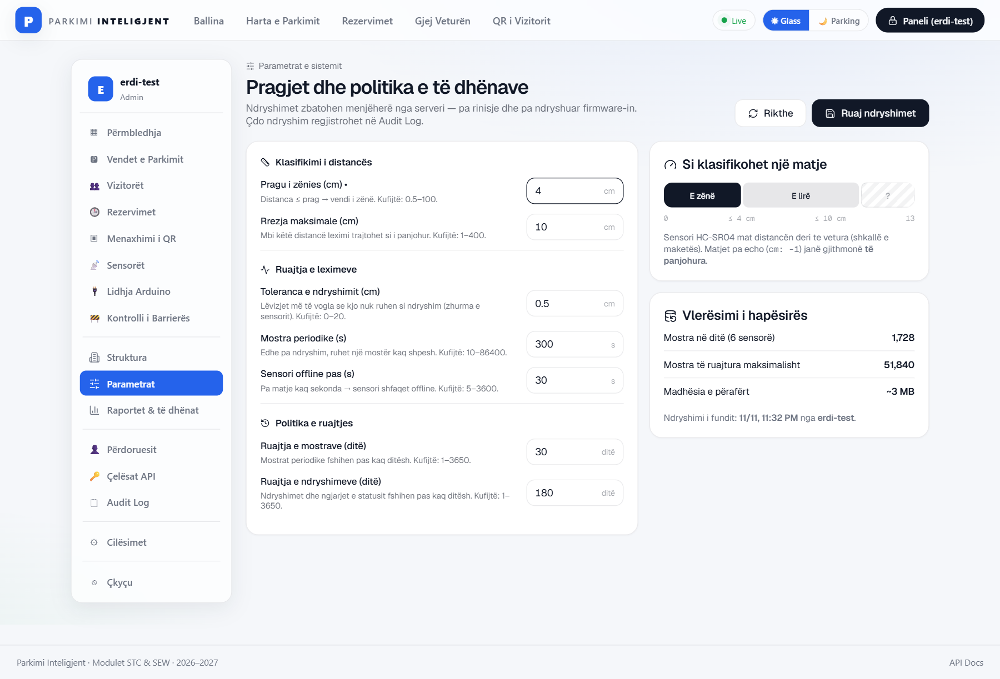
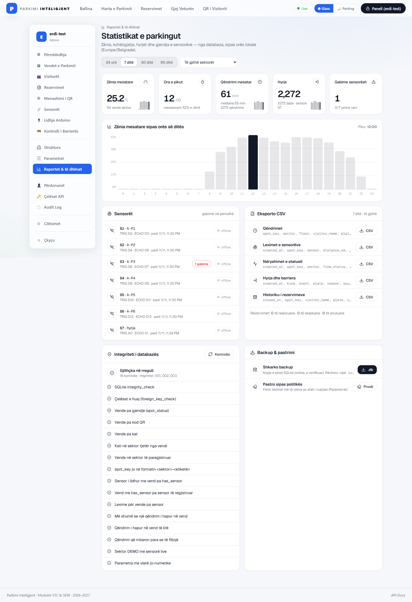
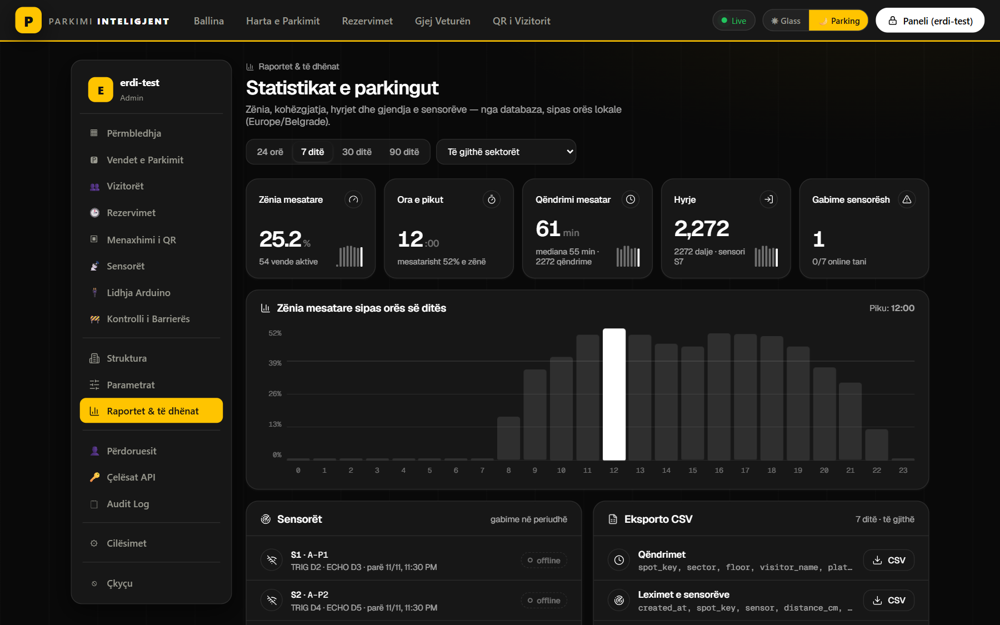
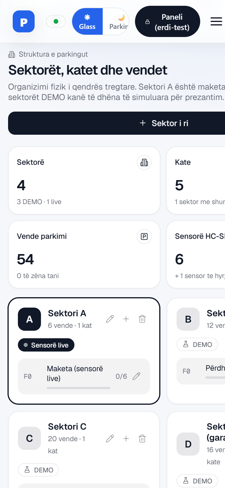
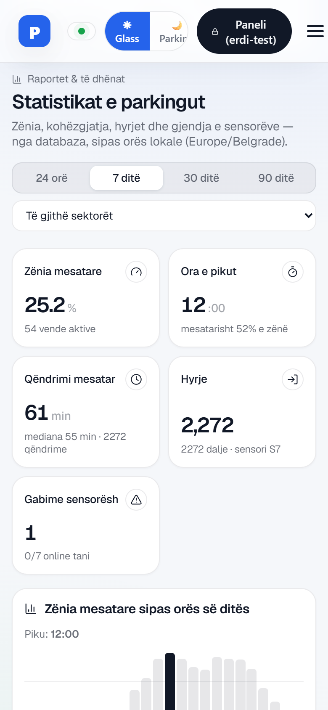

# Erdi: databaza e parkimit, detyrat D1–D7 (verifikimi)

Dega: `erdi/parking-db` · Stack-u i ekipit: Express + better-sqlite3, HTML/CSS/JS pa framework.
UI i ekipit nuk është ndryshuar; seksionet e reja janë vetëm në `frontend/js/admin-parking.js` dhe `frontend/css/admin-parking.css`
(në `index.html` janë shtuar vetëm rreshtat që i ngarkojnë). Dokumentimi i plotë: [`docs/DATABASE.md`](DATABASE.md).

## Përmbledhja

| Detyra | Çfarë u bë | Statusi | Prova |
|---|---|---|---|
| **D1** Skema e strukturës | Sektorë, kate, vende, sensorë; migrime të numëruara me checksum; plotësim nga të dhënat ekzistuese | ✅ | 4 teste D1 · CLI mbi një DB të formatit të vjetër |
| **D2** Politika e leximeve | Vetëm ndryshimet + mostër periodike; `status_events`; historiku i rezervimeve | ✅ | 4 teste D2 |
| **D3** Statistikat | `GET /api/stats/summary`: zënia për orë, piku, kohëzgjatja, hyrjet, sensorët | ✅ | 2 teste D3 · faqja Raportet |
| **D4** Të dhëna DEMO | `npm run seed:demo`, vetëm sektori D, i përsëritshëm | ✅ | 1 test D4 · sektori D në pamjet |
| **D5** Paneli admin | Struktura (CRUD), Parametrat, Raportet + CSV | ✅ | 5 teste D5 · pamjet 01–07 |
| **D6** Mirëmbajtja | Integriteti (16 kontrolle), backup/restore, pastrimi | ✅ | 4 teste D6 · CLI |
| **D7** Procesi i skemës | Snapshot i skemës, rregullat e migrimeve, review | ✅ | 3 teste D7 |

## Testet: `cd backend && npm test`

**64 / 64 kalojnë** (40 testet ekzistuese të ekipit + 24 të reja). Testet e reja:

`tests/parking-db.test.js` (21)
- D1: migrimet aplikohen një herë, me radhë, dhe janë idempotente
- D1: databaza ekzistuese rihapet pa rikrijuar vende të fshira
- D1: sektorët, katet dhe sensorët plotësohen nga të dhënat e ekipit
- D1: spot_key nuk ndryshohet dhe kati duhet të jetë i të njëjtit sektor
- D2: ruhen vetëm ndryshimet; matjet e njëjta brenda tolerancës injorohen
- D2: pas intervalit të mostrës ruhet një lexim
- D2: çdo ndryshim statusi shkruhet në status_events
- D2: rezervimet e mbyllura kalojnë në historik me rezultatin e duhur
- D3: /api/stats/summary jep zënien për orë, pikun, kohëzgjatjen dhe hyrjet
- D3: zënia llogaritet saktë për një qëndrim të njohur
- D4: seed-i DEMO prek vetëm sektorët DEMO dhe është i përsëritshëm
- D5: CRUD i strukturës kërkon admin dhe ruan rregullat
- D5: vendi me sensor live ose me histori nuk fshihet
- D5: operatori lexon strukturën por nuk e ndryshon
- D5: parametrat validohen dhe pragu i ri zbatohet menjëherë
- D5: eksporti CSV ka BOM, kokë dhe mbrohet nga formulat
- D6: kontrolli i integritetit kalon dhe zbulon një problem të futur me qëllim
- D6: pastrimi fshin vetëm të dhënat më të vjetra se politika
- D6: backup → restore rikthen të dhënat dhe ruan kopje sigurie
- D6: GET /api/admin/backup shkarkon një databazë të vlefshme (vetëm admin)
- API publike: /api/sectors liston sektorët aktivë me katet

`tests/schema.test.js` (3)
- D7: skema përputhet me src/db/schema.snapshot.sql
- D7: emrat e migrimeve janë të numëruar pa vrima dhe pa dublikime
- D7: një migrim i aplikuar që ndryshohet më pas refuzohet

## Kontrollet me dorë

**CLI** (mbi një kopje të databazës në formatin e vjetër, para migrimeve):
- nisja e backend-it aplikon 001–003 pa humbur vende, sesione apo rezervime
- `npm run seed:demo` (dy herë, i njëjti rezultat) → `npm run db:check` (të gjitha kontrollet OK)
- `npm run db:backup` → `npm run db:restore -- <skedari>` → të dhënat kthehen, kopja e sigurisë krijohet
- `npm run db:purge` fshin vetëm të dhënat më të vjetra se politika

**Shfletuesi** (backend lokal, SQLite, llogari admin testimi):
- Struktura: krijim / ndryshim / çaktivizim / fshirje sektori, kati dhe vendi; fshirja e bllokuar për vende me histori
- Përzgjedhja, drafti i formës dhe fokusi mbeten kur paneli rifreskohet live (SSE)
- Parametrat: ruajtja shkruhet në `audit_log` me diff; pragu kthehet në 3 cm pas testit
- Raportet: KPI, grafiku për orë me pikun, sensorët, integriteti "Gjithçka në rregull", CSV (580 rreshta për sektorin B, 7 ditë) hapet në Excel
- Tema e errët, telefon 390 px pa scroll horizontal, fonti Geist ngarkohet, ikonat Lucide njëngjyrëshe

## Pamjet

| | |
|---|---|
| **Struktura**  | **Vend i ri**  |
| **Parametrat**  | **Raportet**  |
| **Raportet, tema e errët**  | **Telefon**   |

## Shënime për ekipin

- Teksti te seksioni **Cilësimet** (i Emirit) ende thotë se pragjet vijnë nga `.env`; tani ndryshohen te **Parametrat**. Nuk e ndryshova sepse nuk është pjesa ime.
- Harta e Isrës shfaq vetëm A/B/C; sektori DEMO D shihet te Struktura dhe Raportet.
- Ikonat: nënbashkësi e Lucide v0.469.0 (ISC), skanuar me SkillSpector: SAFE. Efektet NumberTicker dhe spotlight: Magic UI (MIT).
- Asgjë nuk shkon në Neon; databaza mbetet SQLite derisa aplikacioni të vendoset online.
